# Hurricane Beast 9.16" Sensor Display

A Windows app that replaces HT PLAYER for Hurricane Beast USB sensor screens (USB `33C3:7788`, shown as a COM port). It streams a live sensor dashboard to the screen and includes a full theme editor.

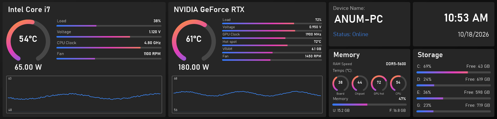

## Screenshots

**Dashboard** – live preview of what the screen shows, live readings, brightness and frame rate.

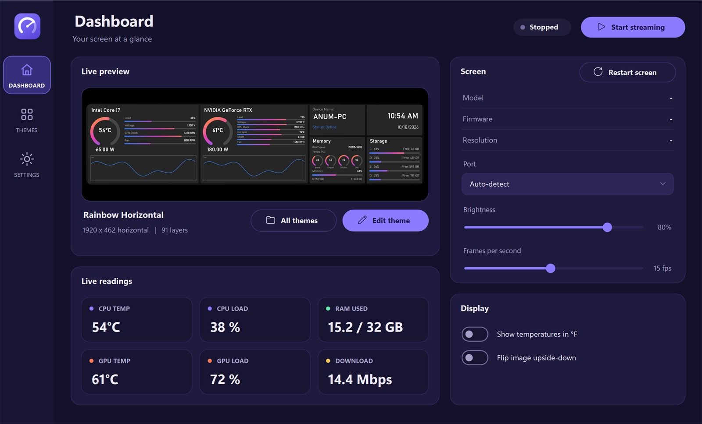

**Theme editor** – drag, resize and rotate elements, pick from gauges, graphs, meters, weather, text, shapes and frames.

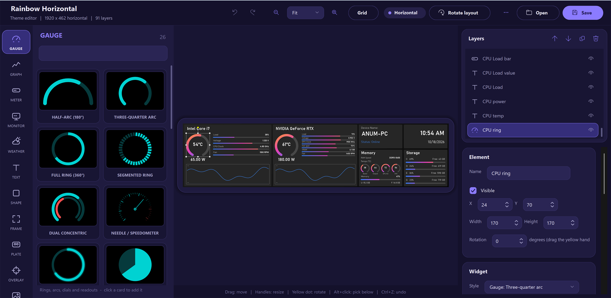

**Themes** – built-in themes (horizontal and vertical) and your own, with search.

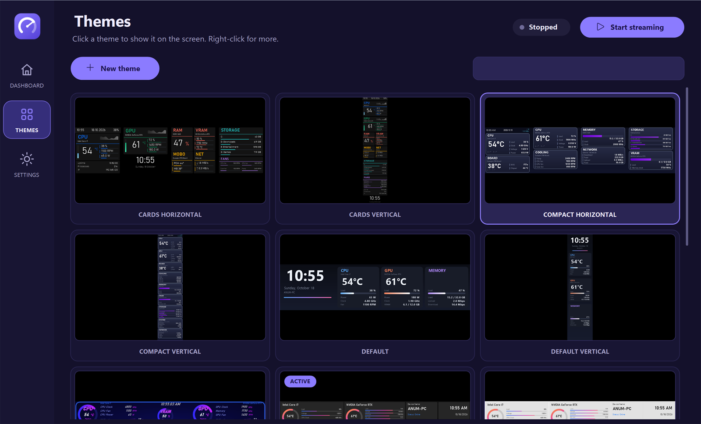

**Color picker** – hue ring, saturation/brightness disc, opacity, hex, RGB, screen eyedropper and presets.

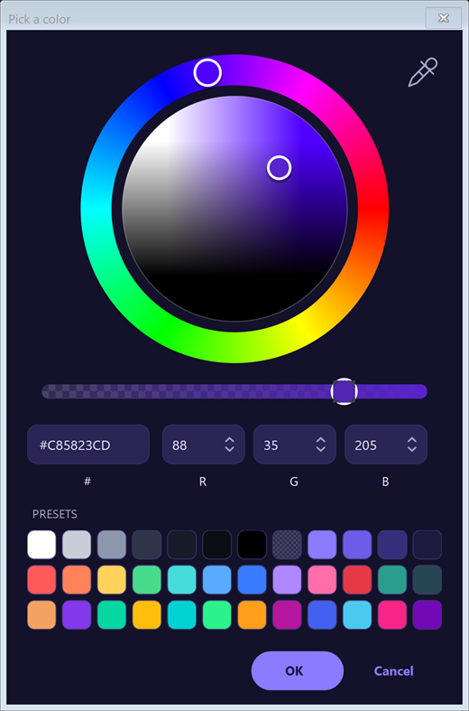

### Built-in themes

| | |
|---|---|
| 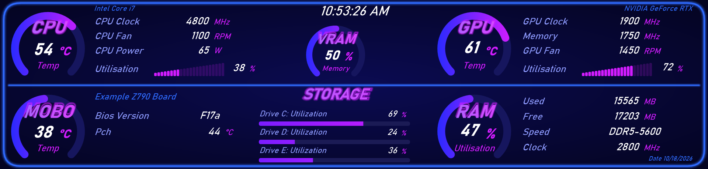 | 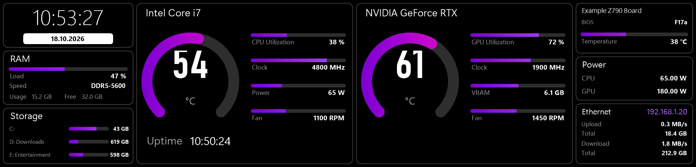 |
| 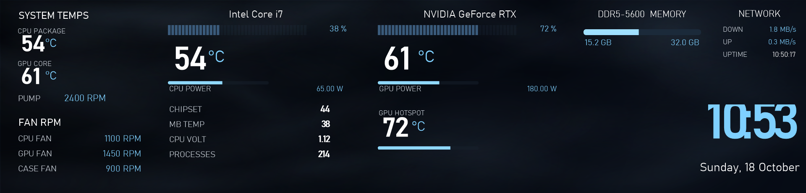 | 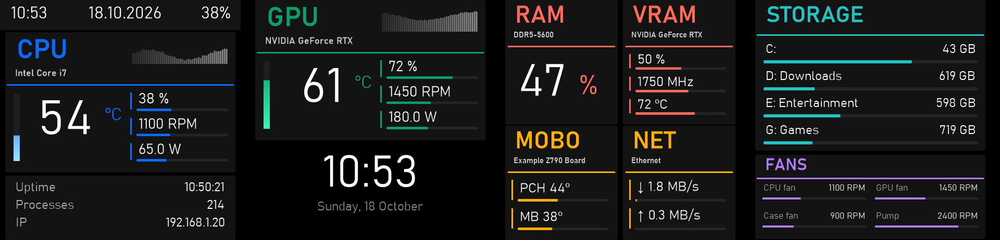 |
| 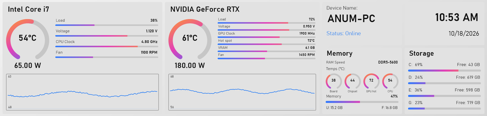 | |

Vertical themes for portrait mounting:

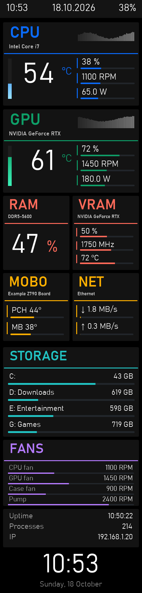 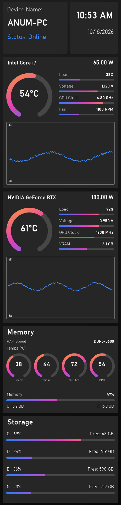 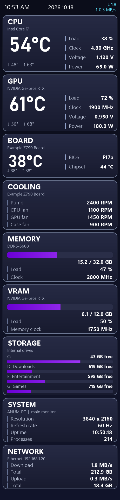

*The pictures above use sample sensor values.*

## Features
- Live CPU, GPU, RAM, VRAM, fan, network and drive sensors (LibreHardwareMonitor). Drives are listed with their real letters and names. Upload and download speed (Mbps, MB/s, or text with its own unit), and the Windows volume and mute state.
- Theme editor: text, shapes, glow, charts, gauges, graphs, meters, date/time formats, images, GIFs and MP4 (also as backgrounds), undo/redo, layers, rotation, and a design-time grid with snapping.
- Gradients with up to 10 colors (linear or circular), solid colors, and a wheel color picker with an eyedropper.
- Weather element: sun, moon, clouds, rain, snow, storm and fog pictures that follow the real weather (Open-Meteo), plus `{weather.*}` tokens. Set the city on the Settings page; empty means detect it from the internet connection.
- Horizontal (1920x462) and vertical (462x1920) themes.
- Built-in themes: Default, Neon Dashboard, Tile, Cards, Compact, Smoky and Rainbow (dark and light, horizontal and vertical variants).
- Custom fonts: drop `.ttf` or `.otf` files into `%AppData%\HurricaneBeastPanel\fonts`.
- Tray app, autostart, brightness, frame rate, and a Restart screen button.

## Build
Requires the .NET 10 SDK on Windows.

```
cd HurricaneBeastPanel
dotnet build -c Release -o bin\dev
```

CPU temperature and power need administrator rights, so the app asks for elevation on start. They also need the free [PawnIO](https://pawnio.eu) driver, which the sensor library uses to read the CPU; the app offers to install it (Settings page), or install it once yourself and restart the app.

## Installer
`installer\build-installer.ps1` publishes the app and builds `release\HurricaneBeastPanel-Setup-<version>.exe` with [Inno Setup 6](https://jrsoftware.org/isinfo.php). The installer checks for the PawnIO driver and offers to install it (winget), open pawnio.eu, or skip it.

## Build on it for other screens
The community is free to build on this project, including for other screen brands such as TURZX. The sensor reading, theme renderer and editor do not depend on a particular screen: a new brand needs its own **screen driver** (finding the device, its protocol and its frame format). Drivers sit behind two small interfaces in `Screens/IScreenDriver.cs`; the Hurricane Beast driver and a Simulator driver (no hardware needed) are complete examples. See [docs/ADDING_A_SCREEN.md](docs/ADDING_A_SCREEN.md).

All we ask is that you **give credit**: please mention this project and link back to it in your README or about page. It will be appreciated. The MIT license (see `LICENSE`) also requires keeping the copyright notice in copies of the code.

## Credits and third-party software
Hurricane Beast Panel is by Anum Amir. It uses [LibreHardwareMonitor](https://github.com/LibreHardwareMonitor/LibreHardwareMonitor) for sensors, [OpenCvSharp](https://github.com/shimat/opencvsharp) for video backgrounds, [Open-Meteo](https://open-meteo.com) for weather, and the [PawnIO](https://pawnio.eu) driver for CPU readings. Each has its own license and belongs to its authors.

## Protocol notes
Packet: `55 AA len(2) cmd payload sum(2)`. Commands: `0x06` info, `0x11` frame (JPEG, 462x1920) and keepalive, `0x03` brightness, `0x01` restart. DTR must be enabled on the serial port.

## Regenerating the screenshots
The pictures in `docs/screenshots` come from development flags that use sample data, so no personal sensor values appear:

```
HurricaneBeastPanel.exe --render-demo out.png "Rainbow Horizontal"   # a theme with sample values
set HB_DEMO_DATA=1                                                    # sample values in the app windows
HurricaneBeastPanel.exe --main-only --shot dashboard.png
HurricaneBeastPanel.exe --editor-only --theme-name "Rainbow Horizontal" --shot editor.png
HurricaneBeastPanel.exe --picker-test picker.png
```
